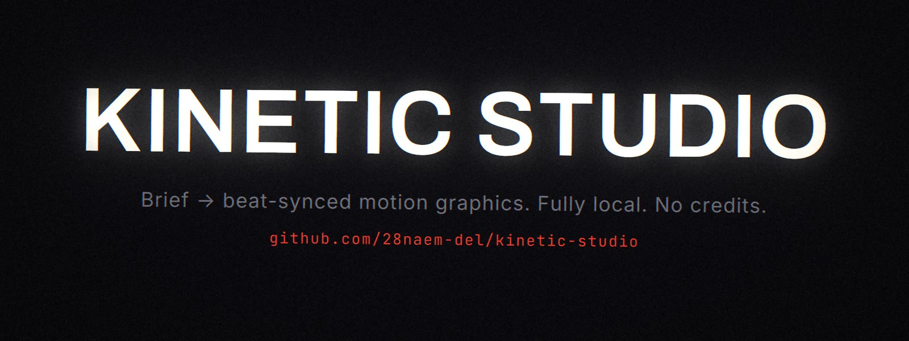
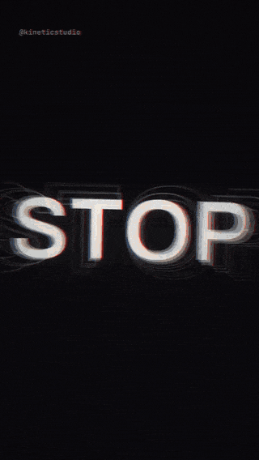
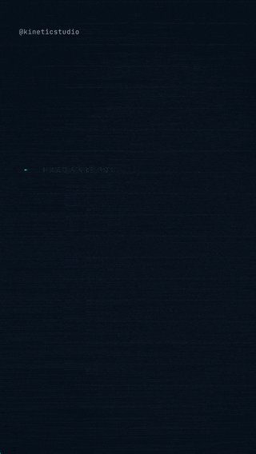
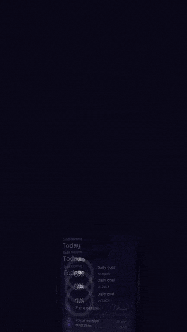
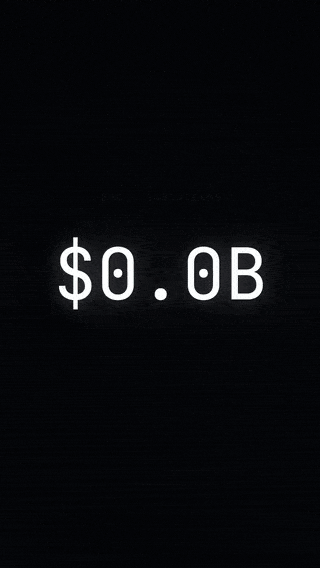
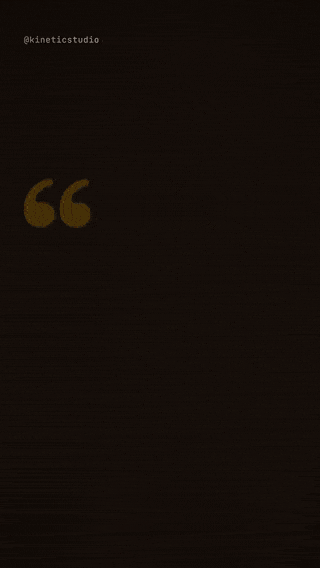
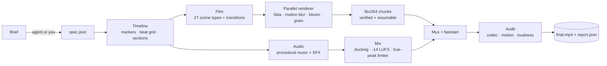

<p align="center">
  
</p>

<h1 align="center">Kinetic Studio</h1>

<p align="center"><b>Brief -> beat-synced motion-graphics video, fully local, no credits.</b></p>

<p align="center">
  <a href="LICENSE"></a>
  
  <a href="https://github.com/28naem-del/kinetic-studio/actions/workflows/ci.yml"></a>
  
</p>

Kinetic Studio turns a short JSON spec (which an agent can write from a one-line brief) into a
finished vertical or landscape video. You get beat-synced kinetic type, explainers, app promos,
data stories and karaoke quote clips. Every frame, note and whoosh is generated on your machine,
with original procedural music and sound design. The mix is normalised to -14 LUFS and every
render is quality-audited automatically.

No subscriptions, no API keys, no render credits and no stock-music licences.

## Modes

| Kinetic teaser | Explainer | Product promo | Data story | Social quote |
|:---:|:---:|:---:|:---:|:---:|
|  |  |  |  |  |
| `kinetic` | `explainer` | `promo` | `data` | `social` |
| Huge beat-synced words, whips, 3D type, flashes | Title cards, definitions, labelled diagrams, sources | Phone mockups, feature callouts, CTA, logo sting | Counters, bar/line/candle charts, tickers | Pull-quotes, karaoke captions with word highlight |
| [`demos/kinetic_teaser.mp4`](demos/kinetic_teaser.mp4) | [`demos/explainer_cpu_cache.mp4`](demos/explainer_cpu_cache.mp4) | [`demos/promo_app.mp4`](demos/promo_app.mp4) | [`demos/data_dashboard.mp4`](demos/data_dashboard.mp4) | [`demos/social_quote.mp4`](demos/social_quote.mp4) |

The MP4s in `demos/` are 720x1280 previews. The full 1080x1920 masters are attached to the
[v0.1.0 release](https://github.com/28naem-del/kinetic-studio/releases/tag/v0.1.0). Each demo is
rendered from the matching spec in [`examples/`](examples).

| | |
|---|---|
| Formats | 9:16 1080x1920 · 16:9 1920x1080 · 1:1 1080x1080 · 4:5 1080x1350 · 30/60 fps · `--4k` |
| Output | H.264 (yuv420p, BT.709) + AAC 48 kHz, `+faststart`, ready for Reels, TikTok, Shorts and X |
| Audio | 5 procedural music styles and 20 synthesised SFX, auto-placed on cuts and hits, -14 LUFS / -1 dBTP |
| Speed | A 12 s 1080x1920@30 clip renders in about 25 s on an 8-core machine (parallel, RAM-aware workers) |
| Scenes | 27 scene types; any scene can be used in any mode |

## How it works



Timeline markers drive everything: sections (with energy 0–3), cues, captions, sources, SFX and
hits. Times can be seconds, beats (`4b`), bars (`bar3`) or expressions on named markers
(`drop-2b`). Music, camera energy, flashes and sound all read the same timeline, so picture and
sound stay locked. See [`docs/ARCHITECTURE.md`](docs/ARCHITECTURE.md).

## Install

Requirements: Python 3.10+, and FFmpeg with libx264 (`ffmpeg` and `ffprobe` on PATH). Runs on
Linux or macOS (Windows via WSL); 4 GB free RAM is recommended.

```bash
git clone https://github.com/28naem-del/kinetic-studio.git
cd kinetic-studio
bash install.sh          # creates .venv, installs skia-python, numpy, opencv-python-headless
bin/kstudio modes
```

You can also run `pip install .` to get a `kstudio` command on your PATH. Contributors should use
`bash install.sh --dev` (adds pytest, ruff, mypy and pre-commit).

## Quickstart

Every mode works the same way: `new` copies a working example, you edit the spec, `preview` shows
stills in about a second, and `render` writes the MP4 and runs the audit.

```bash
bin/kstudio new <mode> my_video      # mode: kinetic | explainer | promo | data | social
$EDITOR my_video/spec.json           # change the words, numbers, colours
bin/kstudio preview my_video         # stills + contact sheet in ~1 s
bin/kstudio render my_video          # -> my_video/out/my_video_reel.mp4 (+ audit report)
```

<details>
<summary><b>kinetic</b>: beat-synced type teaser</summary>

```jsonc
{
  "mode": "kinetic",
  "music": { "style": "drive", "bpm": 128 },
  "markers": [ { "kind": "section", "at": "drop", "name": "drop", "energy": 3 } ],
  "scenes": [
    { "type": "slam", "words": ["STOP", "SCROLLING"], "dur": "2b" },
    { "type": "type3d", "text": "LAUNCH", "dur": "4b" },
    { "type": "burst", "id": "drop", "text": "NOW", "dur": "4b", "transition": "flash" }
  ]
}
```
</details>

<details>
<summary><b>explainer</b>: education with diagrams and sources</summary>

```bash
bin/kstudio new explainer cache_explainer
bin/kstudio render cache_explainer
```
Uses `title`, `definition`, `diagram` (nodes, edges, callouts), `bullets` and `end_card`.
Add a `source` marker to show a citation lower-third. See [`examples/explainer/spec.json`](examples/explainer/spec.json).
</details>

<details>
<summary><b>promo</b>: product / app promo</summary>

```bash
bin/kstudio new promo my_app
# set the "device" scene's "screen" key to your screenshot path
bin/kstudio render my_app --preset landscape
```
Uses `device`, `features`, `cta` and `logo`. See [`examples/promo/spec.json`](examples/promo/spec.json).
</details>

<details>
<summary><b>data</b>: stats / dashboard story</summary>

```bash
bin/kstudio new data weekly_stats
bin/kstudio render weekly_stats --fps 60
```
Uses `counter`, `candles`, `bars`, `line` and `ticker`. The example numbers are illustrative; label real data with its source.
</details>

<details>
<summary><b>social</b>: quote and karaoke captions</summary>

```bash
bin/kstudio new social quote_clip
bin/kstudio render quote_clip --preset square
```
Uses `quote` and `karaoke` (word-timed captions with an active-word pill). Drop in `music.file` to use your own track; its tempo and beats are detected automatically.
</details>

## CLI reference

| command | what it does |
|---|---|
| `kstudio modes` | list modes with their default theme, music style/BPM and transition |
| `kstudio scenes [-v] [type]` | list scene types and their parameters ([`docs/SCENES.md`](docs/SCENES.md)) |
| `kstudio new <mode> <dir> [--force]` | start a project from a mode example |
| `kstudio info <spec> [--json]` | validate and print the resolved timeline |
| `kstudio preview <spec> [--at T] [--preset P] [--scale S]` | render stills and a contact sheet |
| `kstudio render <spec> [-o OUT] [--preset P] [--fps N] [--quality draft\|standard\|high] [--4k] [--workers N] [--fresh] [--no-audit]` | render the final MP4 (parallel, resumable) |
| `kstudio audit <video> [--mode M] [--json]` | audit a finished video |
| `kstudio mix <spec> [-o OUT]` | render the soundtrack only |
| `kstudio beats <audio>` | detect a music file's tempo and beat phase |
| `kstudio sfx <dir>` | export the synthesised SFX kit as WAVs |

`<spec>` can be a project folder or a `spec.json` path. Presets: `reel` (9:16), `landscape` (16:9),
`square` (1:1), `portrait` (4:5). Set `KSTUDIO_WORKERS` to fix the worker count.

## Use it as an agent skill

Kinetic Studio works as a skill for Grok Bot, Claude, Cursor and other agents. Put this folder
where your agent loads skills (or point it at [`SKILL.md`](SKILL.md)). The skill tells the agent
how to choose a mode, turn a brief into a spec, preview, render and read the audit. It also
includes wording rules for health and finance content. [`plugin.json`](plugin.json) describes the
entrypoint, install step and commands for plugin-style loaders.

Example prompt: *"Make a 12-second vertical teaser for our launch on Friday, words: STOP
SCROLLING / MEET NOVA / SHIP FASTER."*

## FAQ

**Does it need a GPU or any API key?** No. It renders on the CPU with Skia and FFmpeg and never
calls a network service.

**Can I use my own music?** Yes. Set `"music": {"file": "track.mp3"}`. The tempo and beat phase
are detected so beat-measured scenes land on the beat. You are responsible for the track's rights.

**Is the generated music royalty-free?** The procedural music and SFX are synthesised by this
project's code at render time; no samples are bundled.

**A render crashed or I pressed Ctrl-C.** Re-run the same command; finished chunks are kept and
rendering resumes. Use `--fresh` to start over.

**Why does the audit flag black frames on the data demo?** The terminal theme is intentionally
dark; the audit reports it but the checks still pass.

**Windows?** Use WSL2 with FFmpeg installed inside it.

## Roadmap

- [ ] `pip` package on PyPI
- [ ] Subtitle import (SRT/VTT) for karaoke scenes
- [ ] More themes and a theme gallery
- [ ] Lottie/SVG asset scene
- [ ] Optional hardware encoders (VideoToolbox, NVENC)
- [ ] Web preview of the timeline

Ideas and pull requests are welcome; see [CONTRIBUTING.md](CONTRIBUTING.md).

## Responsible use

The explainer mode is built for education. For health topics, describe what is *studied*, never
dosing or claims, and keep the "For learning only. Not medical advice." end card. Data examples
are illustrative; label them as such. You are responsible for the text and any media you add.

## Credits

Inspired by Scenario's kinetic-film skill; original implementation, no shared code.

Fonts: Archivo, Inter, Fraunces, JetBrains Mono and Space Grotesk (SIL OFL 1.1). See
[THIRD_PARTY_NOTICES.md](THIRD_PARTY_NOTICES.md).

## Licence

[MIT](LICENSE) © 2026 Naem / Aristotle Intelligence. Bundled fonts are SIL OFL 1.1; FFmpeg is an
external tool you install separately.
