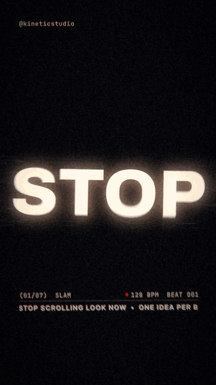
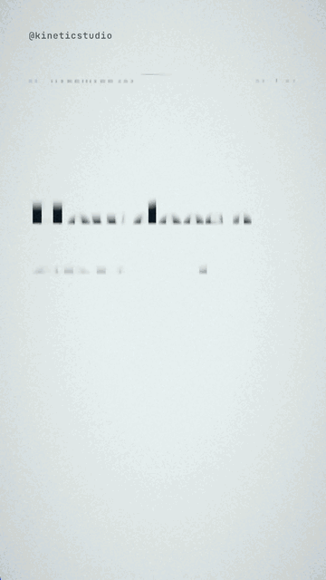
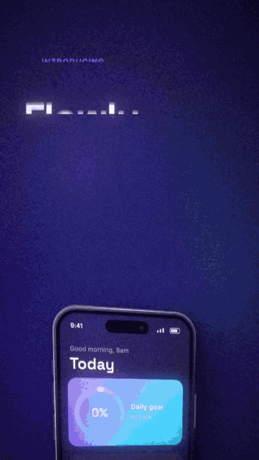
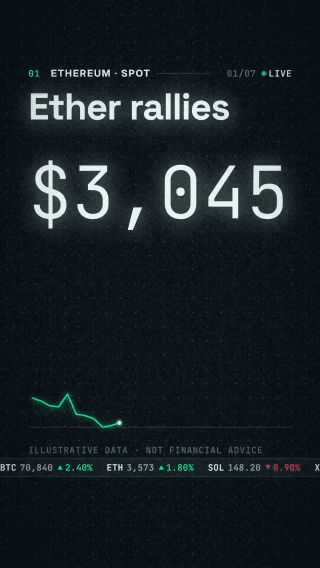
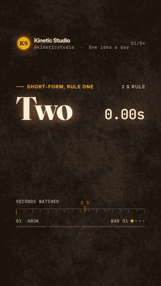
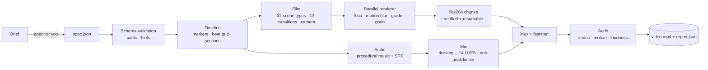

<h1 align="center">Kinetic Studio</h1>

<p align="center"><b>Turn a one-line brief into a beat-synced motion-graphics video, on your own machine, from any agent.</b></p>

<p align="center">
  <a href="LICENSE"></a>
  
  <a href="https://github.com/28naem-del/kinetic-studio/actions/workflows/ci.yml"></a>
  <a href="docs/quickstarts/README.md"></a>
  <a href="SKILL.md"></a>
</p>

<table align="center">
  <tr>
    <td align="center"></td>
    <td align="center"></td>
    <td align="center"></td>
    <td align="center"></td>
    <td align="center"></td>
  </tr>
  <tr>
    <td align="center"><code>kinetic</code></td>
    <td align="center"><code>explainer</code></td>
    <td align="center"><code>promo</code></td>
    <td align="center"><code>data</code></td>
    <td align="center"><code>social</code></td>
  </tr>
</table>

A small JSON spec (scenes on a beat grid plus timeline markers) becomes a finished MP4 with
original procedural music and sound design, mixed to -14 LUFS and checked by an automatic audit.
The core renderer generates video and procedural audio on your CPU without API keys, accounts,
render credits or stock-music licences. The optional [swap backend](docs/SWAP.md) instead sends
your chosen video and character image to the ComfyUI server you configure; review that data
boundary before enabling it. Each demo above comes from its matching spec in [`examples/`](examples).

## 30-second quickstart

**From an agent.** Register the MCP server (any MCP client; needs [uv](https://docs.astral.sh/uv/)
and ffmpeg):

```bash
uvx --from git+https://github.com/28naem-del/kinetic-studio kstudio-mcp
```

then ask: *"Make a 10-second kinetic reel that says SHIP IT FRIDAY, preview it, render it."*

**From a terminal.**

```bash
git clone https://github.com/28naem-del/kinetic-studio.git && cd kinetic-studio
bash install.sh                    # .venv with skia-python, numpy, opencv
bin/kstudio new kinetic my-reel    # starter spec from the mode's example
bin/kstudio render my-reel         # -> my-reel/out/my-reel_reel.mp4 + audit report
```

## Works with any agent

[AutoGen](docs/quickstarts/autogen.md) ·
[Claude Code](docs/quickstarts/claude-code.md) ·
[Cline](docs/quickstarts/cline.md) ·
[Codex CLI](docs/quickstarts/codex-cli.md) ·
[Continue](docs/quickstarts/continue.md) ·
[CrewAI](docs/quickstarts/crewai.md) ·
[Cursor](docs/quickstarts/cursor.md) ·
[Dify](docs/quickstarts/dify.md) ·
[Gemini CLI](docs/quickstarts/gemini-cli.md) ·
[LangChain / LangGraph](docs/quickstarts/langchain.md) ·
[n8n](docs/quickstarts/n8n.md) ·
[OpenHands](docs/quickstarts/openhands.md) ·
[Windsurf](docs/quickstarts/windsurf.md) ·
[plain Python](docs/quickstarts/python.md) ·
[shell / curl](docs/quickstarts/shell.md)

15 quickstart pages cover these integrations. Four ways in, one engine and one JSON contract:

| interface | how |
|---|---|
| MCP server | `kstudio-mcp` or `python -m kstudio.mcp_server`: stdio by default, streamable HTTP with `--http 8765`; tools `list_modes`, `list_scenes`, `get_schema`, `validate_spec`, `new_spec`, `preview`, `render` (with progress), `audit`, plus `swap` (requires an optional configured backend): nine advertised tools, eight core plus swap |
| Function calling | strict tool schemas in [`docs/tools/`](docs/tools/README.md), dispatched with `kstudio.mcp_server.run_tool(name, arguments)` |
| Command line | `kstudio --json <command>` prints one JSON object; stable exit codes (`kstudio exit-codes`) |
| Skill | [`SKILL.md`](SKILL.md) (also at [`skills/kinetic-studio/`](skills/kinetic-studio/SKILL.md)): workflow, beat rules, spec contract, per-mode writing rules |

For model readers: [`llms.txt`](llms.txt) and [`llms-full.txt`](llms-full.txt).

## Features

- **Five modes**, each with an example spec, theme, music style, camera feel and default
  transition: `kinetic` (type teasers), `explainer`, `promo` (app and product launches), `data`
  (counters and charts) and `social` (quotes and karaoke captions).
- **32 scene types**, usable in any mode: slams, stacks, marquees, 3D type, scrambles, countdowns,
  bursts; covers, definitions, diagrams, bullets, key facts; device mock-ups, feature lists, calls to
  action, brand cards; counters, line, candlestick and bar charts, stat grids, tickers; hooks,
  quotes, karaoke, follow cards; titles, text, images, logos, end cards and local video clips. See [`docs/SCENES.md`](docs/SCENES.md).
- **Beat-locked timing**: lengths and times in beats and bars (`"4b"`, `"1/2b"`, `"bar3"`) or named
  markers with offsets (`"drop-2b"`); sections with energy 0-3 drive music layers and camera;
  `snap` puts seconds on the grid; tempo and downbeat are detected from your own music file.
- **13 transitions** with beat-length windows and their own sounds: cut, flash, cross, fade (an
  alias of cross), dissolve, whip, push, zoom, squash, wipe (rect, circle, diagonal, type), slice,
  split and `match`, which hands a shared element from one scene to the next.
- **Film look**: 2.5D camera with parallax and continuity across cuts, a 12-column layout grid and
  type scale, linear-light motion blur, per-theme colour grade, bloom, vignette and grain.
- **Sound**: five procedural music styles (`drive`, `calm`, `bright`, `pulse`, `lofi`) and 29
  synthesised sound effects placed on cuts and hits; ducking, -14 LUFS and a -1 dBTP true-peak limiter.
- **Output**: 9:16, 16:9, 1:1 and 4:5 presets, 24-60 fps, `--4k`; H.264 High (yuv420p, BT.709) with
  AAC 48 kHz and `+faststart`.
- **Rendering**: deterministic, parallel, RAM-aware workers; 2-second chunks that resume after an
  interruption. A 15-second 1080x1920 reel takes about 1-3 minutes at standard quality on a 10-core
  laptop; previews (stills and a contact sheet) take seconds.
- **Audit** of every render: codec, frame rate, frame count, duration, motion ratio, longest hold,
  black frames, loudness, true peak and A/V gap, with per-mode thresholds.
- **Agent-ready contract**: a JSON Schema generated from the engine, validation errors with JSON
  Pointer paths and fix hints, a repair prompt, and `kstudio brief` to build a prompt pack for any model.

## How it works



Timeline markers drive everything: sections (with energy), cues, captions, sources, sound effects
and hits. Music, camera energy, flashes and sound all read the same timeline, so picture and sound
stay locked. Module map: [`docs/ARCHITECTURE.md`](docs/ARCHITECTURE.md).

## Install

Requirements: Python 3.10+ and FFmpeg with libx264 (`ffmpeg` and `ffprobe` on PATH). On minimal
Linux also install `libegl1 libgl1` (for skia-python). Linux or macOS (Windows via WSL2); 4 GB of
free RAM recommended. `kstudio doctor` checks everything.

```bash
git clone https://github.com/28naem-del/kinetic-studio.git
cd kinetic-studio
bash install.sh          # creates .venv; contributors: bash install.sh --dev
bin/kstudio doctor
```

`pip install .` puts `kstudio`, `kinetic-studio` and `kstudio-mcp` on your PATH.
Runtime distributions bundle examples, fonts, workflows and required notices; they are not a
complete offline copy of the repository documentation and demo gallery. For all quickstarts,
tool-schema exports, scripts and demos, use the
[full GitHub repository](https://github.com/28naem-del/kinetic-studio).

## Command line

| command | what it does |
|---|---|
| `kstudio modes` | modes with their theme, music style and tempo, and transition |
| `kstudio scenes [-v] [type]` | scene types and their parameters |
| `kstudio new <mode> <dir> [--force]` | start a project from a mode's example |
| `kstudio schema [--mode M] [--types T]` | the spec JSON Schema |
| `kstudio validate <spec>` | schema check and dry build; errors with JSON Pointer paths |
| `kstudio brief "<brief>" [--mode M]` | prompt pack to turn a brief into a spec with any model |
| `kstudio info <spec>` | resolved timeline and beat-grid lint |
| `kstudio preview <spec> [-o DIR] [--at T] [--preset P] [--scale S]` | stills and a contact sheet |
| `kstudio render <spec> [-o OUT] [--preset P] [--fps N] [--quality draft\|standard\|high] [--4k] [--workers N] [--fresh] [--snap] [--no-audit]` | the final MP4 (parallel, resumable, audited) |
| `kstudio audit <video> [--mode M]` | audit a supported finished video |
| `kstudio mix <spec>` · `beats <audio>` · `sfx <dir>` | soundtrack only · tempo detection · export the sound kit |
| `kstudio doctor` · `exit-codes` | check dependencies · print the exit-code table |

`<spec>` is a project folder or a `spec.json`. Add `--json` to any command for one JSON object on
stdout ([`docs/CLI.md`](docs/CLI.md)). Presets: `reel`/`story` (9:16), `landscape`/`youtube` (16:9), `square` (1:1), `portrait` (4:5).

Audits use `reference-1080-v2`: coded short edge >=144 px, long edge <=4096 px and <=9M pixels,
with a bounded, no-upscale analysis grid. Tiny/extreme geometry, explicit non-square pixels or
nonidentity rotation are rejected, not waived. Thresholds stay unchanged; non-1080 sampled metrics
can change. See the [audit input policy and measurement basis](docs/CLI.md#audit-input-policy-and-measurement-basis).

## Docs

| | |
|---|---|
| [Quickstarts](docs/quickstarts/README.md) | one page per agent framework |
| [Skill](SKILL.md) | how an agent should go from brief to video |
| [Scene reference](docs/SCENES.md) | every scene, parameter and default; shared keys; transitions |
| [Command line](docs/CLI.md) | every command, its JSON output and exit codes |
| [Tool definitions](docs/tools/README.md) | MCP list, function-calling schemas, manifest |
| [Architecture](docs/ARCHITECTURE.md) | modules and pipeline |
| [Changelog](CHANGELOG.md) · [Contributing](CONTRIBUTING.md) · [Security](SECURITY.md) | |

## FAQ

**Does it need a GPU or an API key?** The core renderer needs neither: it runs on the CPU with
Skia and FFmpeg without network calls after installation. The MCP transport uses only the Python
standard library. Optional [swap](docs/SWAP.md) uses a separately configured ComfyUI/GPU backend
and uploads the input video and character image to it; a clip with `source.swap` may trigger that
request during rendering when configured. Only enable it for inputs you agree to share with that
server. HTTP MCP access is unauthenticated: keep it on localhost or a trusted network.

**Can I use my own music?** Yes: `"music": {"file": "track.mp3"}`. Tempo and beat phase are
detected so beat-measured scenes land on the beat. You are responsible for the track's rights.

**Is the generated music royalty-free?** The music and sound effects are synthesised by this
project's code at render time; no samples are bundled.

**A render stopped halfway.** Run the same command again; finished chunks are reused. `--fresh`
starts over.

**Windows?** Use WSL2 with FFmpeg installed inside it.

## Responsible use

The explainer mode is built for education. For health topics, describe what is *studied*, never
dosing or claims, and keep the "For learning only. Not medical advice." end card. Data examples
are illustrative; label them as such. You are responsible for the text and any media you add, and
for what you publish.

## Credits and third-party notices

Inspired by Scenario's kinetic-film skill; original implementation, no shared code.
Fonts: Archivo, Inter, Fraunces, JetBrains Mono and Space Grotesk (SIL OFL 1.1). FFmpeg is an
external tool you install separately. Full list: [THIRD_PARTY_NOTICES.md](THIRD_PARTY_NOTICES.md).

## Licence

[MIT](LICENSE) © 2026 Naem / Aristotle Intelligence.
